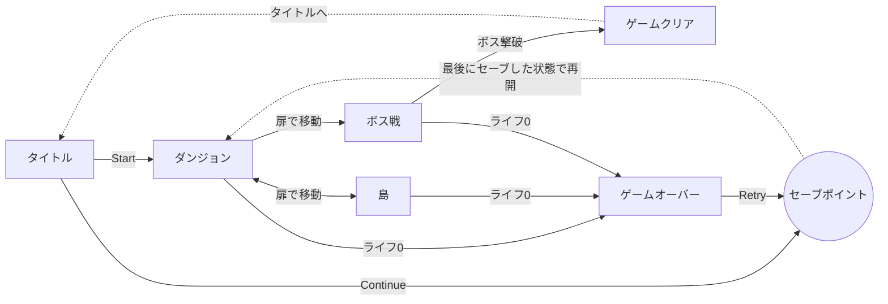
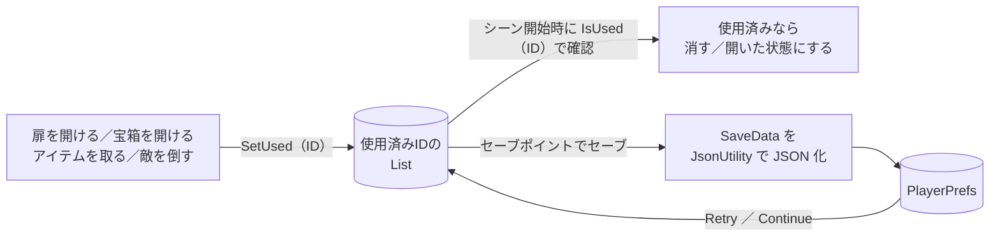

{\rtf1}
# IslandAdventure
## 2Dトップビューアクションゲーム
島の各地を巡り鍵を集めてボスの部屋の扉を開けてボスを倒す見下ろし型の2Dアクションゲームです。

## 目次

- [概要](#概要)
- [スクリーンショット](#スクリーンショット)
- [遊び方](#遊び方)
- [主な機能](#主な機能)
- [技術的なポイント](#技術的なポイント)
- [開発環境](#開発環境)
- [実行方法](#実行方法)
- [ディレクトリ構成](#ディレクトリ構成)
- [苦労した点と解決方法](#苦労した点と解決方法)
- [今後の改善予定](#今後の改善予定)
- [この制作で学んだこと](#この制作で学んだこと)
- [使用素材・クレジット](#使用素材クレジット)

## 概要

| 項目                 | 内容                                    |
| -------------------- | --------------------------------------- |
| ジャンル             | 見下ろし型2Dアクション・アドベンチャー  |
| 制作期間             | 2026年10月〜（約2週間）                 |
| 制作人数             | 1人                                     |
| 担当範囲             | 全般                                    |
| 使用言語             | C#                                      |
| Unityバージョン      | 6000.3.24f1                             |
| 対応プラットフォーム | Windows（キーボード／ゲームパッド対応） |
> [!NOTE]
> 教材をなぞるだけでなく、「接近攻撃をすることでゲームが詰まないようにする」「任意にセーブを行える」「死んだらセーブした状態から再開できる」「矢の本数が設定値を下回っているならスタート時、再開時にその本数まで補充する」など、
> 実際のゲームで当たり前に求められる詰まないための仕様を**独自に加えて実装**したことが、この作品の見どころです。

## 遊び方　
島の各地にある鍵を手に入れて中心の島の鍵のかかった扉を開けて、その中にいるボスを倒すゲームです。
セーブポイントでセーブをしておけば、ゲームオーバーの際やコンティニューした際にその場所から再開できます。

### 操作方法

| 操作                             | キーボード                  | ゲームパッド                    |
| -------------------------------- | --------------------------- | ------------------------------- |
| 移動                             | `W` `A` `S` `D` ／ 矢印キー | 左スティック ／ 十字キー        |
| 弓を撃つ（**長押しでチャージ**） | `Enter`                     | Westボタン（Xbox: X ／ PS: □）  |
| 剣で斬る                         | `Space`                     | Southボタン（Xbox: A ／ PS: ×） |
| セーブ（セーブポイント上で）     | `E`                         | Eastボタン（Xbox: B ／ PS: ○）  |
| メニュー選択・決定               | 矢印キー ＋ `Enter`         | 十字キー ＋ 決定ボタン          |

### ゲームの流れ



## 主な機能
- **アクション**
    - 8方向移動と、向きに合わせたキャラクターアニメーション
    - 弓：ボタン長押しでチャージし、溜め切ると**攻撃力2倍**（溜め具合をゲージと弓の変形で表示）
    - 剣：近接攻撃と斬撃エフェクト
- **探索**
    - 宝箱からアイテム（カギ・矢・回復）が出現
    - カギを消費して扉を開ける
    - 扉（Exit）の番号でシーン間を移動し、入った扉の前に出現
    - ダンジョンでは、プレイヤーの向きに合わせて回転するライトで暗闇を照らす
- **敵・ボス**
    - プレイヤーが近づくと追いかけてくる敵
    - プレイヤーに向けて弾を撃つボス
- **セーブ／ロード**
    - 開けた扉・開けた宝箱・取ったアイテム・倒した敵を記録し、**シーンを移動しても状態を保持**
    - セーブポイントでセーブし、ゲームオーバー時の Retry やタイトルの Continue で**最後にセーブした状態から再開**
    - セーブデータがないときは Continue ボタンを押せないように制御
- **UI・サウンド**
    - ライフ・チャージゲージ・矢とカギの所持数を表示
    - キーボード／ゲームパッドで操作できるゲームオーバー・タイトル画面
    - シーンに応じたBGMの切り替えと効果音（AudioMixerで音量を管理）
    
## 技術的なポイント

テキストベースではゲームとしては最低限成立するものの、ゲームプレイの不便や、メンテナンス非効率と、欠陥ポイントも多いと感じました。<br>
この作品はゲームプレイが快適になるように以下の機能を独自に考え、実装しました。

### 1. セーブ／ロードの仕組み（独自設計）

「どのオブジェクトをもう使ったか」を**IDのリスト**で管理するようにしまいた。<br>
**セーブ対象物が独自のIDを所持するよう** スクリプトに組み込み、撃破や取得のタイミングで各IDをセーブ管理者（SaveDataManager）がもつリストに刻みます。<br>
ゲームオーバー時はリスト内容の更新をなかったことに、セーブ時にはリスト内容を **JSON に変換して PlayerPrefs に保存**しています。<br>
また、任意のタイミングでセーブができるよう **SavePointに触れた状態で、特定のボタンをおすとSaveメソッド**　という仕組みにしています。



- **IDの自動生成**：`シーン名_タグ_座標` からIDを作るので、オブジェクトを置くたびにインスペクターで番号を振る必要がありません。
- **シーンをまたいで保持**：使用済みIDのリストを `static` にして、シーンを読み込み直しても消えないようにしています。
- **宝箱の中身の扱い**：宝箱から出たアイテムには「宝箱のID ＋ `_Item`」というIDを付けています。宝箱を開けたまま中身を取らずに部屋を出ても、戻ったときにもう一度出てきます。
- **セーブ内容をクラスにまとめる**：`[System.Serializable]` の `SaveData` クラスに、使用済みID・シーン名・セーブ位置・所持数をまとめ、`JsonUtility` で1つの文字列にしています。

```csharp
// SaveDataManager.cs（抜粋）
public static void Save(Vector3 savePointPos)
{
    SaveData data = new SaveData();
    data.usedIds = new List<string>(_usedIds);
    data.sceneName = SceneManager.GetActiveScene().name;
    data.savePointPosition = savePointPos;
    data.keys = ItemKeeper.hasKeys;
    data.arrows = ItemKeeper.hasArrows;

    string json = JsonUtility.ToJson(data);     // SaveData → JSON文字列
    PlayerPrefs.SetString(KEY_SAVE_DATA, json);
    PlayerPrefs.Save();
}
```

### 2. 斬撃アクションの追加

- 攻撃アクションに **「斬撃」を追加** することで、矢のアイテムがなくてもゲーム進行ができるようにしました。
- 斬撃は発生すると、**短い時間プレイヤーの周囲に独自の当たり判定** が発生します。
- 同じスクリプト「PlayerAttack.cs」において、整理がつきやすいようそれぞれの攻撃を別々にメソッド化し、InputActionアセットのAttackアクションは弓矢に使われていたので、テキストでは使う予定のなかったJumpアクションを斬撃に割り当てました。
- Arrow（矢）もslash（斬撃）も **攻撃のインターバル** をつけてバトルのメリハリを体現しています。攻撃発生時にコルーチンを起動させ、**コルーチンが発動している間は次の攻撃ができない** というつくりにしています。

```csharp
// PlayerAttack.cs（抜粋)

 //InputSystem上の特定のActionが入る変数
 private InputAction _bowAttackAction;           // 弓Attackアクション
 private InputAction _swordAttackAction;           // 剣Attackアクション

    // 弓Attackアクションのコールバック
    void OnAttackCallback(InputAction.CallbackContext context)
    {
        // 矢を持っている
        if (ItemKeeper.hasArrows > 0)
        {
            if(_swordAttackCoroutine == null)
            ShootArrow();       //矢を発射
        }
    }

    // 剣Attackアクションのコールバック
    void OnLongPressStarted(InputAction.CallbackContext context)
    {
        Slash(); //剣による攻撃
    }

            //Attackアクションにコールバックを設定
        PlayerInput input = GetComponent<PlayerInput>();
        _bowAttackAction = input.currentActionMap.FindAction("Attack");
        _bowAttackAction.canceled += OnAttackCallback;                  // キャンセルコールバック登録

        _swordAttackAction = input.currentActionMap.FindAction("Jump");
        _swordAttackAction.started += OnLongPressStarted;                 // 開始コールバック登録

    //剣を振る
    void Slash()
    {
        //ソードも、矢もコルーチンがまだ発動してなければ実行(null)
        if(_swordAttackCoroutine == null && _arrowAttackCoroutine == null)
        {
            SoundManager.soundManager.SEPlay(SEType.Slash);//SEを鳴らす

            _bowObj.SetActive(false); //弓の存在を一時消しておく
            float currentAngleZ = _playerMove.GetAngle(); //現在のPlayer角度を取得
            Quaternion r = Quaternion.Euler(0, 0, currentAngleZ + 90); //角度をラジアン値に変換
            //しかるべき角度でソードエフェクトを生成
            GameObject swordEffectObj = Instantiate(_swordEffectPrefab, transform.position, r);
            swordEffectObj.transform.SetParent(transform);　//Playerをエフェクトの親とする

            //Playerの角度情報（すなわち向き）に応じて生成したエフェクトの位置を調整
            if (currentAngleZ >= -135 && currentAngleZ <= -45)
            {
                swordEffectObj.transform.localPosition = new Vector3(0,0.3f,0);
            }
            else if (currentAngleZ >= 45 && currentAngleZ <= 135)
            {
                swordEffectObj.transform.localPosition = new Vector3(0, 0.2f, 0);
            }

            //ソードを維持→やがて消滅　を時限式に行うコルーチンを発動
            _swordAttackCoroutine = StartCoroutine(SwordAttack(swordEffectObj));
        }
    }

//コルーチンSwordAttackの作成（ソードを維持→やがて消滅）
IEnumerator SwordAttack(GameObject swordEffectObj)
{
    yield return new WaitForSeconds(0.3f); //0.3秒経つまで待つ
    Destroy(swordEffectObj); //ソードエフェクトを消す
    _swordAttackCoroutine = null; //コルーチン情報をnullにする
    _bowObj.SetActive(true);  //一時的に非表示にしていた矢を復活
}


```

また、テキストベースの中でも難しい機能をしっかり理解して実装したものです。
### 3. ゲーム全体の管理

- **状態管理**：`GameState`（InGame／GameOver／GameClear／GameEnd）で、ゲームの状態に応じてプレイヤーや敵の処理を止めています。
- **シーン移動**：扉ごとに番号と向きを持たせ、移動先のシーンで同じ番号の扉の前にプレイヤーを配置しています。
- **サウンド**：`SoundManager` を `DontDestroyOnLoad` で1つだけ残す**シングルトン**にして、シーンをまたいでもBGMが途切れないようにしています。


## 開発環境

| 種類           | 名前・バージョン                                    |
| -------------- | --------------------------------------------------- |
| ゲームエンジン | Unity 6000.3.24f1（Unity 6）                        |
| 言語           | C#                                                  |
| レンダリング   | Universal Render Pipeline 17.3.0（2D Light を使用） |
| 入力           | Input System 1.20.0                                 |
| 主なパッケージ | 2D Tilemap、2D Animation、Unity UI、TextMesh Pro    |
| エディタ       | Visual Studio                                       |
| バージョン管理 | Git ／ GitHub                                       |

## 実行方法

> [!IMPORTANT]
> **Unity 6000.3.24f1** で開いてください。違うバージョンで開くと、変換が走ったり正しく動かなかったりすることがあります。

1. このリポジトリをクローンします。
    ```bash
    git clone https://github.com/Dyna-Rise/IslandAdventure.git
    ```
2. Unity Hub の **「追加」→「ディスクから加える」** で、クローンしたフォルダを選びます。
3. TextMeshPro の インポート Window → TextMeshPro →各種importしておきます。
4. プロジェクトを開いたら、`Assets/Scenes/Title.unity` を開いて再生ボタンを押します。

<details>
<summary>セーブデータを消したいとき</summary>

Unity エディタのメニュー **Edit → Clear All PlayerPrefs** で削除できます。
タイトル画面の Continue ボタンが押せなくなれば削除できています。

</details>

## ディレクトリ構成

```text
Assets/
├── Scenes/            # Title / DungeonMap / Island1 / BossStage
├── Scripts/
│   ├── Player/        # 移動・攻撃・アイテム所持・ライト・カメラ
│   ├── Enemy/         # 敵の追跡とダメージ処理
│   ├── Boss/          # ボスの攻撃と弾
│   ├── SaveData.cs         # セーブする内容をまとめたクラス
│   ├── SaveDataManager.cs  # セーブ／ロードとIDの管理
│   ├── SavePoint.cs        # セーブポイント
│   ├── RoomManager.cs      # シーン移動時のプレイヤー配置・BGM切り替え
│   ├── SoundManager.cs     # BGM・効果音の管理
│   └── UIController.cs     # ライフ・ゲージ・所持数・ゲームオーバー画面
├── Prefabs/           # Player、Enemy、Door、ItemBox、SavePoint など
├── Settings/          # Input Actions、URP の設定
└── Sounds/            # BGM・効果音
```

## 苦労した点と解決方法

## 今後の改善予定
- [ ] セーブしたときに画面にメッセージを表示する
- [ ] 音量設定画面を追加する
- [ ] スコアシステムを実装する
- [ ] 敵の種類を増やす

## この制作で学んだこと

- Unity の基本（GameObject・コンポーネント・プレハブ・シーン）と、C# でゲームの仕組みを組み立てる方法
- `static` 変数で、シーンをまたいでデータを持ち回る方法と、その注意点
- `List` と `JsonUtility` を使った**データの保存と復元**
- Input System の**アクションマップ・インタラクション**の使い分け
- うまく動かないときに、**インスペクターの設定とコードの両方から原因を切り分ける**考え方
- Git でこまめにコミットし、作業の区切りを記録すること

## 使用素材・クレジット

| 素材               | 作者・配布元                    | 用途                               |
| ------------------ | ------------------------------- | ---------------------------------- |
| Pixel Adventure 1  | Pixel Frog（Unity Asset Store） | 敵キャラ・タイルマップデータ                         |
| Sunny Land         | ansimuz（Unity Asset Store）    | 敵キャラ・タイルマップデータ                         |
| 教材書籍の付属素材 |  たのしい2Dゲームの作り方 第3版 Unity 6ではじめるゲーム開発入門：翔泳社       | キャラクター・タイルマップ・UI画像 |
| BGM・効果音        | 同書籍、「効果音ラボ」        | BGM・効果音                        |

各素材の著作権は、それぞれの作者に帰属します。

---